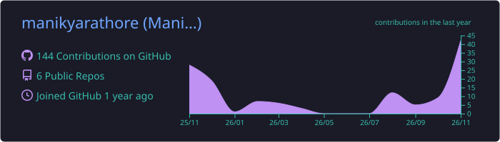
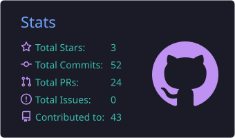
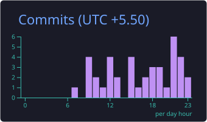
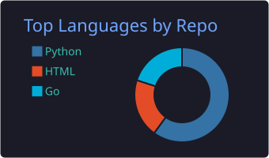
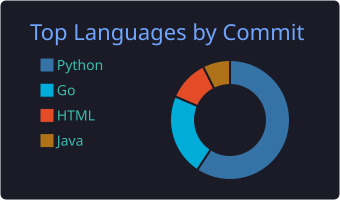

  
  
  
  
  
  

##  About

 B.Tech Computer Science and Business Systems, **MPSTME NMIMS Mumbai**, CGPA **9.44** 
 First author of a **UAV intrusion detection paper** (under review) and a **NISAR radar** agriculture manuscript 
 Wrote a **Python to Go compiler from scratch** (about 12,500 lines of Go, 6 phases, fuzz tested against CPython) 
 Built an **RL trained flood relief drone** in MuJoCo that cut delivery miss distance by 89% 
 Built a **timetable generator** the CSBS HoD picked for a trial run: 1,023 sessions, 0 clashes 
 Merged PRs into **Heritrix3 (Internet Archive)** and contributed to OpenStreetMap, Django, AnkiDroid and more 
 Ask me about: compilers, constraint solving, simulation, Bitcoin protocol, UAV security

##  Research

 **System-Level Evaluation of Lightweight Intrusion Detection and Response for UAV Formations** 
Under review, 2026 · First author, with S. Naruka, A. Surve, I. Ranjan and S. Puthran

 **Agricultural Land Classification from NISAR L-Band GCOV Backscatter with Independent Scene Validation** 
Manuscript, 2026 · With D. Parekh

##  Open Source

Merged **PR #693** and **PR #691** in [**Heritrix3**](https://github.com/internetarchive/heritrix3) (Internet Archive). Contributions across OpenStreetMap, 52North, FOSSi Foundation, Django, AnkiDroid, St. Jude ProteinPaint, OpenScienceLabs, INCF and IOOS.

##  Tech Stack

  

**Languages** 

**Web and Systems** 

**ML, Vision and Robotics** 

**Blockchain** 

**Tools and Platforms** 

##  Stats

  
  

  

  
  

  
  

##  Problem Solving

549+ problems solved on LeetCode, plus GFG, CSES and Striver.

##  Certifications

AI Receptive Software Development (Clemson, Coursera) · Machine Learning Specialization (Stanford and DeepLearning.AI) · Nexus (Blockchain, DSA)

